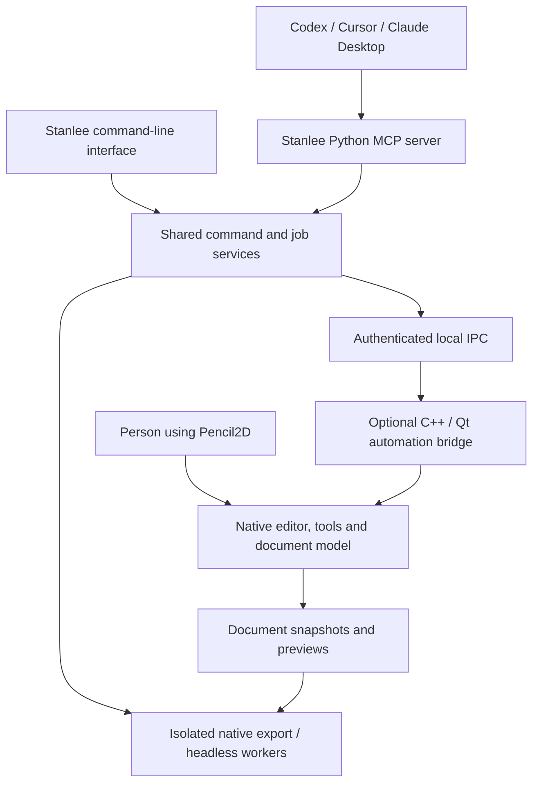

# Stanlee: complete Pencil2D MCP and native automation bridge

## 1. Agreed outcome and definition of complete

Build **`splitintech/stanlee`** as a new public, GPL-licensed project that lets external AI clients inspect, operate, draw in, animate with, and export from Pencil2D.

The decisions from our questions are:

| Area | Decision |
|---|---|
| Ownership | `splitintech/stanlee`; upstream contributions authored through `splitintech` |
| Platforms | macOS, Windows, and Linux; prove the local Mac workflow first |
| Application integration | A separately installed, bridge-enabled Pencil2D build |
| AI functionality | External AI clients supply intelligence; Stanlee supplies application control |
| Execution | Interactive desktop and unattended/headless automation |
| Collaboration | Human and agent share a live document, with conflict detection and undo |
| Licensing | GPL-2.0-only for our code, preserving upstream and dependency notices |
| Initial demonstration | Create, draw, edit, animate, save/reopen, and export one project |
| Upstream target | Optional native C++/Qt bridge, tests, and documentation |
| Supported clients | Codex, Cursor, and Claude Desktop |
| Distribution | Installable MCP package and application builds |
| Publication | Public repository from the first commit |
| Signing | Unsigned experimental previews; signed stable Mac and Windows builds |
| Editing authority | Autonomous edits within granted workspaces, with undo and recovery |
| Upstream timing | Approach maintainers after our working alpha |

**“Complete” means application coverage, not a predetermined tool count.** The inspected application currently has **124 declared main-window actions**, plus tool properties, dialogs, dynamic actions, and manager operations. Every supported user-facing capability must appear in a coverage register, have a documented API mapping, and have acceptance evidence. New upstream capabilities must trigger a coverage review. [Main-window definition](https://github.com/pencil2d/pencil/blob/master/app/ui/mainwindow2.ui)

A released stock Pencil2D executable will initially support Stanlee’s compatible CLI operations. Full live-editor control requires our bridge-enabled build until an upstream release contains the bridge.

## 2. Architecture and public interfaces

### Components

**Stanlee server and CLI**

- Use Python 3.11+, with Python 3.12 as the initial development runtime.
- Start with the official **MCP Python SDK 2.3.0**, pinned with its dependencies. Use SDK protocol negotiation and compatibility support rather than implementing a protocol loop ourselves.
- Expose MCP tools, resources, image previews, workflow prompts, progress, and cancellation.
- Use **stdio** for the first release. The selected scope does not require a hosted service or network-facing MCP endpoint.
- Share application commands between MCP and CLI so they cannot develop different editing or export behavior. [Official Python SDK](https://py.sdk.modelcontextprotocol.io/), [SDK release](https://github.com/modelcontextprotocol/python-sdk/releases/tag/v2.3.0)

**Native bridge**

- Build an optional C++17/Qt integration into Pencil2D.
- Use private local sockets on macOS/Linux and named pipes on Windows through Qt’s local IPC facilities.
- Authenticate each connection using a per-session token. Protect discovery files and socket parent directories; do not rely solely on socket permissions, particularly on macOS.
- Keep the native bridge independent of Python, AI providers, and the MCP protocol so it is suitable for upstream review. [Qt local IPC documentation](https://doc.qt.io/qt-6/qlocalserver.html)

**Application integration**

Reuse Pencil2D’s existing editor, managers, canvas, undo system, and renderers. The integration points are `MainWindow2`, `Editor`, `Object`, `ScribbleArea`, and their managers. Extract reusable application operations where existing implementations are coupled to dialogs. [Pencil2D architecture guide](https://github.com/pencil2d/pencil/blob/master/docs/dive-into-code.md)

### Command contract

Create a versioned command registry shared by the bridge, Python server, CLI, documentation, and tests.

Each operation specifies:

- Inputs, outputs, applicable layer/document types, and required capability.
- Whether it changes document content, view state, application settings, or files.
- Undo behavior, revision requirements, cancellation behavior, and possible failures.
- Mapping to native implementation and coverage-register entries.

Public identifiers include `session_id`, `document_id`, `layer_id`, document revision, operation ID, and job ID. IDs are scoped to the application session; a closed or reopened document invalidates old session handles.

Document mutations require an expected revision. Human edits, undo, redo, or another client’s edits advance that revision. Stale commands return a conflict with current state rather than overwriting newer work.

Use structured errors for unsupported capabilities, stale revisions, busy tools, invalid selections, missing assets, unavailable encoders, cancelled operations, and interrupted jobs. Transport failures must remain distinguishable from application failures.

### Capability coverage

| Family | Required functionality |
|---|---|
| Application and sessions | Discover, launch, attach, inspect version/capabilities, identify windows/documents, disconnect, revoke access, close safely |
| Documents | New/open, presets, `.pcl`/`.pclx`, inspect, dirty state, save/save-as, checkpoints, recovery, close/discard |
| Layers | Bitmap/vector/sound/camera creation, selection, names, order, visibility, opacity, properties, deletion, cross-project layer import |
| Timeline | Scrubbing, keyframe creation/duplication/movement/removal, multi-frame selection, exposure, reversing, repositioning, playback range, FPS, looping |
| Drawing tools | Pencil, pen, brush, eraser, bucket, smudge, polyline, eyedropper, selection, movement, hand, camera and applicable tool settings |
| Bitmap and vector editing | Native strokes, pressure-aware samples, fills, colors, selections, transforms, vector paths/control points and supported style changes |
| Camera and viewport | Camera dimensions and keyframes, pan/zoom/rotation, view transforms, flips, centering, grids, guides, onion skinning and display modes |
| Color and palettes | Active colors, palette inspection/editing, import, append/replace, export, supported vector color replacement |
| Sound and assets | Sound import, placement, timing, inspection, playback controls, native audio/video import and export behavior |
| Import/export | Images, numbered sequences, animated images, video/audio, project layers, palettes, stills, image sequences, movies and animation formats supported by the native build |
| Application UI/settings | Panels, layout/locking/reset, shortcuts, preferences, applicable dialogs, application information and help resources |
| Observation | Document snapshots, selected objects, timeline/layer state, rendered frame previews, canvas/window captures, change events |
| Automation operations | Typed batches, checkpoints, jobs, progress, cancellation, timeout handling and diagnostics |

Parameterized tools may cover several related native actions. Full coverage does not require exposing every menu action as a separate MCP tool.

OS file dialogs become explicit path parameters. Help and information actions may return resources instead of opening windows in headless mode. Platform-unavailable capabilities must be reported explicitly with native evidence; they cannot silently disappear from the coverage register.

## 3. Step-by-step implementation

### Step 0 — Approved project plan

This public plan contains only Stanlee-specific requirements. The approved plan and project decisions were persisted before implementation. Private company documents and unrelated plans are excluded.

### Step 1 — Establish the public repositories and reproducible baseline

1. Create public `splitintech/stanlee`.
2. Create the Pencil2D fork under `splitintech/pencil`, preserving upstream history and attribution.
3. Start the application integration from inspected upstream `master` commit `408563a37068daf7f1b4c6a9291daef039be8cb5`; record any subsequent baseline change.
4. Keep application modifications in the fork. Pin that fork revision from Stanlee’s build manifest.
5. Establish GPL notices, contributor guidance, issue templates, release policy, dependency notices, and CI.
6. Create a distinct **Pencil2D–Stanlee** application identity and settings profile so development builds coexist with the normal application.
7. Install the required local Python/Qt/build tools when implementation begins; the current machine does not yet have the full Qt toolchain available.
8. Reproduce upstream builds and tests before adding the bridge.

Use Qt 6 for Stanlee’s distributed application builds. Preserve upstream’s qmake/Qt 5 and Qt 6 compatibility for contributed code; maintain CMake support where applicable. [Upstream build/test matrix](https://github.com/pencil2d/pencil/blob/master/.github/workflows/ci.yml)

**Gate:** an unchanged baseline builds and passes its existing tests on the target platforms.

### Step 2 — Produce the complete coverage register

1. Inventory static and dynamic actions, menus, shortcuts, dialogs, preferences, tools, and manager interfaces.
2. Classify each as a document operation, view operation, settings operation, file operation, information resource, or platform-specific capability.
3. Record its inputs, native preconditions, effects, undo behavior, API mapping, and test requirements.
4. Include controls inside dialogs and tool-option panels; menu enumeration alone is insufficient.
5. Add an upstream-drift check that detects new or removed capabilities.
6. Track implementation, testing, documentation, and platform qualification separately.

**Gate:** every discovered capability has a planned mapping; there are no unexplained omissions.

### Step 3 — Implement the bridge foundation

1. Add a build-time automation option, disabled by default in upstream-style builds.
2. Add explicit runtime activation and application-visible connection status.
3. Implement authenticated local discovery, connection lifecycle, bounded message framing, version negotiation, and capability discovery.
4. Dispatch native operations through the Qt application thread.
5. Observe native signals for document, selection, layer, frame, playback, and history changes.
6. Reject mutations while a human stroke, incompatible modal operation, or conflicting operation is active.
7. Clean up stale discovery records and invalidate handles when a session exits.

No arbitrary C++, Python, shell, or unrestricted QObject invocation is exposed.

**Gate:** a test client can attach, inspect state, receive a change event, and disconnect on all three platforms.

### Step 4 — Implement document ownership, revisions, and recovery

1. Add document creation/opening, inspection, save/save-as, closing, and dirty-state handling.
2. Add revision tracking for both human and agent edits.
3. Implement native checkpoints and recovery without changing the original document path or save state.
4. Implement immutable export snapshots of unsaved documents.
5. Preserve source assets, relative references, original files, and native project compatibility.
6. Require explicit overwrite/discard parameters where those outcomes are intended.
7. Keep normal editing autonomous within the granted workspace.

Do not implement snapshots by temporarily running “Save As” on the person’s active document.

**Gate:** snapshotting, exporting, failure, and recovery leave the active document’s path, dirty state, undo history, and assets correct.

### Step 5 — Implement native editing and undo

1. Expose layer and frame operations.
2. Add native tool selection and property inspection/modification.
3. Add canvas-coordinate stroke input through Pencil2D’s drawing pipeline, including applicable pressure and modifier information.
4. Implement bitmap and vector editing with their native semantics.
5. Integrate with native undo/redo so agent edits are understandable and reversible.
6. Add bounded batches of undoable document operations.
7. Roll back a failed atomic batch through the native history mechanism.

File writes, exports, and settings changes are not included in atomic document-edit batches. Long workflows use checkpoints and explicit steps.

**Gate:** human and agent changes can alternate in one document without lost edits or broken undo.

### Step 6 — Complete the working alpha

Demonstrate one reproducible workflow:

1. Launch Pencil2D–Stanlee and attach through MCP.
2. Create a project with bitmap, vector, sound, and camera layers.
3. Draw native content and modify a vector element.
4. Animate a short sequence using timeline operations.
5. Adjust camera framing and project FPS.
6. Undo and redo an agent edit.
7. Make a human edit and verify that a stale agent command is rejected.
8. Save, close, and reopen the native project.
9. Export through the native CLI with camera, dimensions, and frame-range selection.
10. Return a preview and verified output metadata through MCP.

Publish the experimental alpha and its limitations.

**Gate:** this workflow works on our Mac and passes automated integration tests before upstream outreach begins.

### Step 7 — Begin upstream design engagement

After the alpha gate:

1. Present the working demonstration and a protocol-neutral bridge proposal as `splitintech`.
2. Explain application benefits, optional activation, threading, undo, file handling, testing, and maintenance cost.
3. Follow the project’s forum/Discord guidance for design discussion and use an appropriate GitHub tracking issue.
4. Seek agreement on the native integration boundary before submitting a large feature patch.
5. Keep Stanlee development moving in our fork while feedback is pending.

This starts the contribution process; it does not make Stanlee dependent on upstream accepting the feature.

### Step 8 — Complete the remaining editor surface

Implement the rest of the coverage register:

- Advanced timeline and exposure operations.
- Vector selection, geometry, styles, and applicable color changes.
- Camera keyframes, playback, audio placement and sound controls.
- Viewport transforms, onion skins, overlays, perspective/composition guides and display modes.
- Palette workflows, presets, peg-bar alignment, transparency and repositioning operations.
- Panels, shortcuts, settings, resets, and other applicable application actions.

Use native models and command paths. Refactor reusable dialog logic into callable operations with explicit parameters instead of relying on screen coordinates or translated labels.

**Gate:** every applicable capability is implemented and exercised, including invalid-context behavior.

### Step 9 — Complete native import/export and CLI coverage

Support the native formats and codecs actually available in each shipped build.

1. Wrap all existing CLI behavior: input, repeated export outputs, camera selection, width, height, start frame, end frame, `last`, `last-sound`, transparency, help, version, and compatibility aliases.
2. Add structured capability discovery and preflight validation.
3. Cover all GUI import/export options through typed operations.
4. Use native renderers for bitmap/vector composition, camera transforms, and sound.
5. Export unsaved editor state from an immutable snapshot.
6. Validate resulting files: format, dimensions, frame count, timing, and expected audio.
7. Publish outputs only after successful validation.

The existing CLI takes export FPS from the project; it has no native `--fps` option. Stanlee may offer an FPS override by changing an isolated snapshot before export. It must not fabricate a native flag or change the open document. [CLI parser](https://github.com/pencil2d/pencil/blob/master/app/src/commandlineparser.cpp), [native exporter](https://github.com/pencil2d/pencil/blob/master/app/src/commandlineexporter.cpp)

Unsupported format options must fail clearly. For example, a request for transparency cannot silently succeed when the native movie path does not support it.

**Gate:** Stanlee’s output matches equivalent native application exports.

### Step 10 — Add reliable jobs and headless operation

1. Implement export/import job IDs, state, progress, logs, cancellation, and timeouts.
2. Persist job metadata locally so interrupted work is reported accurately after restart.
3. Run unattended jobs in isolated application processes and settings profiles.
4. Start with one rendering worker; make concurrency configurable.
5. Use temporary output staging and explicit overwrite rules.
6. Terminate only Stanlee-owned worker processes when cancelling.
7. Qualify headless export and editor automation on CI, including Linux virtual-display operation where required.
8. Expose the same services through CLI commands for serving MCP, diagnostics, application discovery, sessions, inspection, commands, export, and job management.

A job is successful only when the native operation and output validation succeed—not merely when a process exits.

### Step 11 — Finish MCP resources, previews, and client setup

1. Expose discoverable operation descriptions and structured capability information.
2. Add resources for document state, layers, timeline, palettes, jobs, and operation documentation.
3. Return native frame previews and contact sheets as appropriate MCP image content.
4. Add workflow prompts for inspection, animation creation, repair, and export.
5. Negotiate optional capabilities such as subscriptions and asynchronous task support; provide job polling where necessary.
6. Provide configuration generators that preserve existing client settings.
7. Test installation, discovery, editing, previews, errors, and export in Codex, Cursor, and Claude Desktop.

Use the official client configuration mechanisms and record tested client versions. Configuration examples must be executable release artifacts, not untested snippets. [Codex MCP documentation](https://learn.chatgpt.com/docs/extend/mcp?surface=cli), [Cursor MCP documentation](https://cursor.com/docs/mcp), [local-server setup](https://modelcontextprotocol.io/docs/develop/connect-local-servers)

### Step 12 — Package and qualify the public release

1. Publish the Python distribution as `stanlee-mcp`, with `stanlee` as its CLI command. The package name was unregistered during this assessment; recheck ownership before publication.
2. Produce macOS universal, Windows x64, and Linux x64 application artifacts.
3. Bundle or declare native runtime/encoder dependencies explicitly.
4. Include source revisions, build manifests, checksums, dependency notices, and provenance.
5. Support clean installation, diagnostics, upgrades, rollback, and uninstall.
6. Keep unsigned alpha artifacts clearly labeled experimental.
7. Provision Mac signing/notarization and Windows signing before stable binary publication.

The current local keychain reports no valid code-signing identities. Signing is therefore an explicit release dependency, not an already-completed capability.

**Gate:** a clean machine on each supported platform can install the release, connect a qualified MCP client, and complete the reference workflow.

## 4. Verification and acceptance

### Required test layers

| Layer | Required evidence |
|---|---|
| Command contracts | Every operation validates inputs, outputs, capabilities, preconditions, and failure states |
| Native unit tests | Existing Pencil2D tests remain green; new bridge/editor tests use the project’s existing test infrastructure |
| Integration | MCP → bridge → native state changes → observable results |
| Coverage register | Every applicable capability has implementation, documentation, and passing tests |
| Human/agent interaction | Stale revisions, human strokes, simultaneous clients, modal state, undo/redo and document replacement |
| File integrity | Save/reopen, snapshots, missing assets, relative paths, Unicode paths, corrupt archives and original-file preservation |
| Rendering | Bitmap, vector, multiple cameras, alpha, audio, FPS and frame-range correctness |
| Job recovery | Cancellation, timeout, worker crash, interrupted output, restart and unavailable encoders |
| Workspace boundaries | Traversal/symlink escapes, unauthorized paths, malformed IPC and invalid session tokens |
| Packaging | Clean install, upgrade, rollback, uninstall and client configuration preservation |
| Platform/client matrix | All three operating systems and the three selected MCP clients |

### Reference fixtures

Maintain versioned projects covering:

- Bitmap drawing, pressure samples, fills, erasing, smudge and selections.
- Vector paths, control points, styles and transformations.
- Multiple layers, visibility, opacity and exposure changes.
- Multiple cameras with animation and differing dimensions.
- Sound timing and mixed bitmap/vector/audio export.
- Historical native projects, missing assets and malformed inputs.
- A longer animation for memory, responsiveness and cancellation testing.

Compare deterministic exports exactly where practical within a pinned renderer. For cross-platform comparisons, use declared fixture-specific tolerances and structural/media assertions; do not claim universal pixel identity across different native environments.

### Completion gates

Stanlee is ready for a stable release only when:

1. The approved company-context plan and context are committed and pushed.
2. The coverage register contains no unexplained or deferred applicable capabilities.
3. Existing and new native, Python, integration, and packaging tests pass.
4. Native exports preserve expected content, framing, timing, transparency and audio.
5. Human edits and unsaved state survive automation, failure, disconnect and recovery.
6. All supported platform/client combinations have recorded acceptance evidence.
7. Stable binary signing requirements are satisfied.
8. Public documentation accurately distinguishes stock-CLI mode, bridge mode, supported capabilities, and known upstream limitations.

## 5. Upstream contribution and maintenance

### Follow the project’s demonstrated review process

The published guidance points to C++/Qt developer documentation and community discussion. Recent merged code PRs target `master`. In an examined feature review, maintainers explicitly required coding-style corrections and subsequent functional approval. These are observed practices; I found no published rule guaranteeing acceptance of an MCP or automation feature. [Contributor guidance](https://www.pencil2d.org/contribute/), [review example](https://github.com/pencil2d/pencil/pull/1999)

Contributed code should match the surrounding project:

- PascalCase classes, camelCase functions, `m`-prefixed members, initialized pointers, and existing brace/layout conventions.
- Appropriate QObject ownership and application-thread behavior.
- Existing manager boundaries, native undo semantics, and test conventions.
- Translatable user-facing strings and minimal unrelated changes.

### Proposed PR sequence

After design feedback, offer independently reviewable contributions:

1. Reusable editor operations and focused regression tests needed by automation.
2. State/revision observation and reliable non-dialog operation interfaces.
3. Optional authenticated local bridge infrastructure.
4. Document, timeline, and layer command support.
5. Native drawing/vector/camera/audio extensions.
6. Export/headless improvements and integration documentation.

Keep the Python MCP server, package distribution, and Stanlee-specific branding in `splitintech/stanlee`. Do not add an AI runtime or Python dependency to Pencil2D itself.

For each upstream PR:

- Branch from current upstream `master`.
- Rebase or update against current upstream changes.
- Link the agreed proposal and provide focused tests and reproduction/demo evidence.
- Run the relevant upstream Qt/platform matrix.
- Address review comments and re-request review.
- Let Pencil2D maintainers decide acceptance and merging.

If maintainers decline the bridge, continue supporting the public Stanlee fork and record that outcome accurately. Upstream acceptance is a separate external milestone from Stanlee’s own implementation, release, and acceptance.

### Ongoing maintenance

- Pin every release to a tested Pencil2D revision, SDK version, bridge protocol version, and toolchain.
- Detect upstream action/API drift before updating the fork.
- Keep a compatibility matrix and migration notes.
- Retain native project compatibility and regression fixtures across releases.
- Report source completion, test results, package publication, binary availability, client qualification, and upstream status separately.
